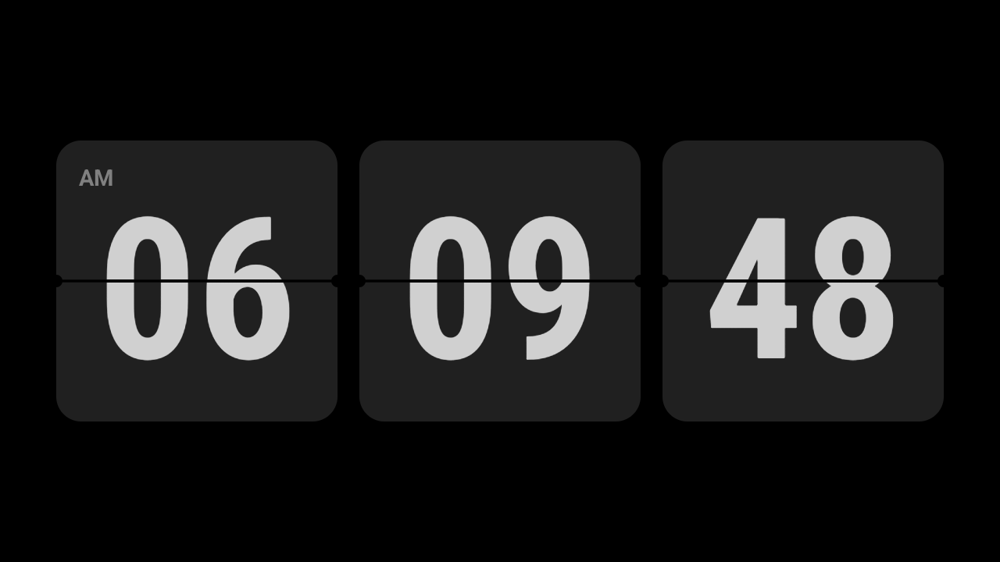
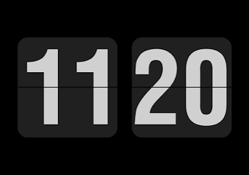

# Android TV Flip Clock

A sleek, hardware-accelerated minimalist 3D flip clock application built for Android TV (Leanback). Features 3 retro flip cards displaying real-time Hours, Minutes, and Seconds with smooth downward turnover animations.



---

## Features

- **3-Tile Flip Display**: Hours, Minutes, and real-time ticking Seconds.
- **Hardware-Accelerated 3D Motion**: Smooth downward flip turnover using `android.graphics.Camera` 3D X-axis rotation and dynamic lighting shadows (runs at 60 FPS natively with zero WebView overhead).
- **Exact Retro Aesthetics**:
  - Pure Pitch Black (`#000000`) OLED-friendly background.
  - Matte Dark Charcoal (`#202020`) card plates.
  - Crisp Silver-Grey (`#D0D0D0`) typography.
  - Horizontal slit seam and mechanical side hinge cutouts.
- **Time Format Toggle**: Press **OK / Enter** on your TV remote (or tap any card) to toggle smoothly between **12-Hour** (with AM/PM indicator) and **24-Hour** mode.
- **Keep Screen Awake**: Integrated window flags prevent Android TV from dimming or sleeping into DreamActivity.
- **Leanback Launcher**: Automatically appears in the Android TV app banner / launcher row.

---

## Preview

| Live TV Render (Hours : Minutes : Seconds) | Reference Inspiration |
|:---:|:---:|
|  |  |

---

## Project Structure

```
tv-flip-clock/
├── app/
│   ├── src/main/
│   │   ├── java/com/ambient/flipclock/
│   │   │   ├── MainActivity.kt           # Clock timer loop & remote controller
│   │   │   └── view/FlipCardView.kt      # Native 3D flip canvas & camera engine
│   │   ├── res/
│   │   │   ├── layout/activity_main.xml  # 3-tile TV layout
│   │   │   └── values/colors.xml         # Exact color palette
│   │   └── AndroidManifest.xml           # Leanback TV permissions & launcher intent
│   └── build.gradle.kts
├── assets/
│   ├── preview.png                       # Live screenshot on Android TV
│   └── reference.png                     # Visual design reference
├── build.gradle.kts
└── settings.gradle.kts
```

---

## Building & Installing

### Requirements
- Android SDK (API 28 - 34)
- JDK 17 or higher
- Android TV connected via ADB

### Build APK
```bash
./gradlew assembleDebug
```

### Install to TV over ADB
```bash
# Connect to your TV (replace with your TV's IP)
adb connect 192.168.0.154:5555

# Install APK
adb install -r app/build/outputs/apk/debug/app-debug.apk

# Launch App
adb shell am start -n com.ambient.flipclock/.MainActivity
```

---

## Controls

| Remote Button | Action |
|---|---|
| **D-Pad Center / OK** | Toggle between 12-Hour and 24-Hour mode |
| **Back** | Exit clock |

---

## License

MIT License. Free to use and modify.
